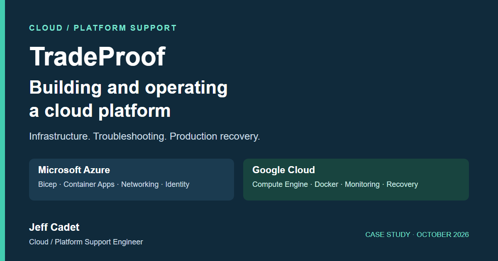
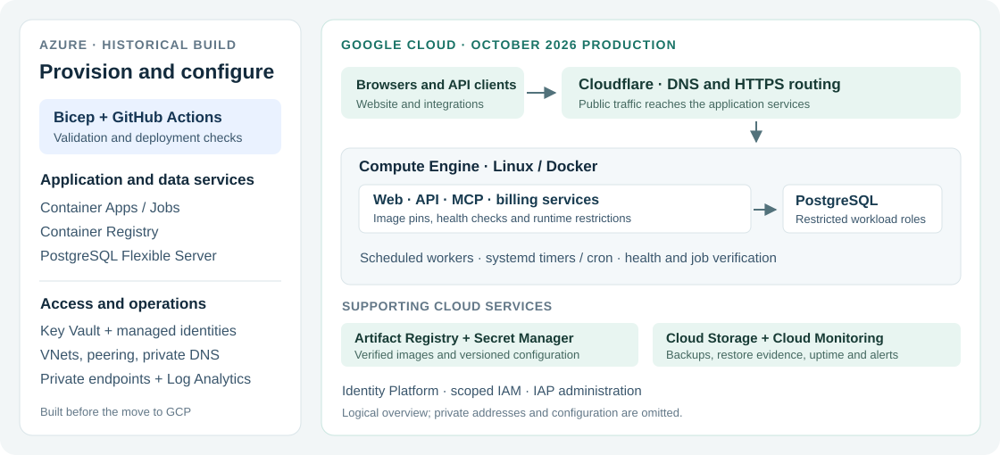

# Building and Operating TradeProof on Azure and Google Cloud

**Jeff Cadet · Cloud / Platform Support Engineer · October 2026**

I built and supported the cloud environment behind TradeProof, a contractor license and insurance verification platform. My work covered infrastructure provisioning, container deployments, networking, identity, monitoring, database recovery and production troubleshooting.

**[Download the one-page overview](TradeProof-Cloud-Platform-Case-Study.pdf)** · [Live platform](https://tradeproof.net) · [About TradeProof](https://tradeproof.net/about)

## The project

The V1.2 platform was initially built on Azure. I then replaced its Azure dependencies and completed its production release on Google Cloud on October 8, 2026. The previous V1.1 production service also ran on Google Cloud; the final data reconciliation and traffic cutover were between those GCP environments.

This case study focuses on cloud operations and support work performed from May through October 2026. Azure work is historical; the production runtime described here is the GCP deployment verified in October 2026.

## What I worked on

| Area | Work performed |
| --- | --- |
| Azure infrastructure | Built Bicep modules and deployed Container Apps, PostgreSQL Flexible Server, virtual networks, peering, private endpoints, private DNS, managed identities, Key Vault and container images in ACR. |
| Google Cloud operations | Deployed Docker workloads on Linux Compute Engine; managed images in Artifact Registry, private objects and backups in Cloud Storage, and versioned configuration in Secret Manager. |
| Networking and access | Troubleshot DNS, private connectivity and HTTPS routing; configured scoped identities, restricted database roles and protected administrative access. |
| CI/CD and releases | Maintained GitHub Actions checks, immutable image references, vulnerability scans, canary checks, staged activation and recovery configurations. |
| Production support | Investigated startup failures, missing runtime dependencies, permission errors, backup failures, configuration drift and scheduled job failures. |
| Monitoring and recovery | Configured uptime monitoring and alerts, verified email delivery, tested restores on isolated infrastructure and documented operational procedures. |

## Infrastructure overview

This is a logical overview. It omits private addresses, resource identifiers and configuration values. It does not imply an active-active or highly available deployment across both clouds.

## Three support investigations

### 1. Azure job deployed successfully but failed at runtime

**Symptom:** A scheduled Key Vault reminder job repeatedly failed even though its cloud resource reported successful provisioning.

**Diagnosis:** Log Analytics showed a missing Python module. The Key Vault SDK was available in the development environment but absent from the runtime image.

**Fix and verification:** Added the runtime dependency, rebuilt the image and tested imports inside the packaged container before deployment. Verified a successful manual execution and the next scheduled execution on July 3, 2026.

**Support lesson:** Check the workload's execution result and logs as well as the cloud resource's provisioning status.

### 2. Backup automation uploaded checksums without the database dump

**Symptom:** Cloud Storage contained checksum files, but the corresponding database dump uploads had failed.

**Diagnosis:** The upload process could not write its local Cloud SDK tracking files. The script then used the successful checksum upload's exit status and removed the local dump.

**Fix and verification:** Set a writable Cloud SDK configuration location, checked each upload result independently and required remote-object verification before local cleanup. Later recovery work used isolated restores to validate usable backups, database contents and application startup.

**Support lesson:** A successful scheduled command or checksum file alone does not establish recoverability.

### 3. Saved recovery configuration had drifted from running services

**Symptom:** Stored recovery configuration no longer fully represented the deployed application and billing services.

**Diagnosis:** Compared running containers and private configuration files against explicit Secret Manager versions. Also found a backup manifest referencing an older, stopped API container.

**Fix and verification:** Updated the recovery versions and backup reference, preserving the previous versions. Independently verified all nine configuration files and checked that serving containers, database permissions and schedules remained unchanged.

**Support lesson:** Recovery needs the current images, configuration and permissions as well as the database backup.

## Release and recovery evidence

| Recorded result | Scope and date |
| --- | --- |
| **Production launch verified** | October 8: full source and target restores, reconciliation, five healthy application services, controlled traffic release and separate public checks. |
| **9.5 million license records** | Rounded from 9,513,402 records recorded in the target database at the final launch capture. This is database scale, not request volume. |
| **21 CI checks passed** | October 11 release: all candidate checks passed while the 19 required branch checks and strict policy remained unchanged. |
| **8,879 backend tests passed** | Same release; reported test coverage was 89.04%. Test results describe that release, not an uptime guarantee. |
| **Zero fixable HIGH/CRITICAL findings** | Exact API and web images scanned for the October 11 release under the existing vulnerability policy. This is a scoped scan result. |
| **7m 43s measured recovery** | September 26 isolated snapshot drill: five applications, public search/navigation and one quota-write check. This did not cover complete authenticated-session or external-provider recovery. |

The October 8 cutover included a planned maintenance window. After the target accepted production writes, the earlier source remained fenced against writes; recovery required reconciliation rather than a DNS-only reversal.

For the October 11 release, I verified the packaged images, checked canaries against production configuration, activated dependencies in order, confirmed the running image identities and observed a successful scheduled worker execution. Existing customer API behavior was covered by synthetic-key tests, without spending a live customer's quota.

## Security and operating practices

- Used separate workload identities and scoped cloud and PostgreSQL permissions.
- Managed secrets through cloud secret services and versioned recovery configuration.
- Applied non-root containers, read-only filesystems and restricted runtime capabilities where supported by the workload.
- Implemented application staff RBAC, passkey verification and audited access changes.
- Kept deployment, troubleshooting, backup and recovery runbooks with dated acceptance records.
- Reviewed compute, storage and CI usage; removed temporary recovery resources after verification.

## Tools used

**Azure:** Bicep, Container Apps and Jobs, Container Registry, PostgreSQL Flexible Server, Virtual Network, private endpoints, private DNS, Key Vault, managed identities, Log Analytics.

**Google Cloud:** Compute Engine, Artifact Registry, Cloud Storage, Secret Manager, Cloud Monitoring, IAM, Identity Platform, Identity-Aware Proxy.

**Operations:** Linux, Docker, PostgreSQL, GitHub Actions, Python, Bash, PowerShell, Cloudflare, Trivy, automated API and browser checks.

## Evidence and scope

Prepared from project task closures, dated deployment records, CI output and recovery receipts reviewed on October 12, 2026. Supporting source records include the May Azure provisioning closures, July scheduled-job repair, September backup/configuration/recovery checks, October 8 launch acceptance and October 11 release verification. Detailed operational records remain private.

This is a selected account of completed work. It does not assert SOC 2 certification, independently audited availability or a guaranteed recovery time. The September snapshot drill and October full launch restores are separate exercises.

## Add this to LinkedIn

**Media title:** TradeProof — Azure & Google Cloud Operations Case Study

**Description:** A practical case study of the cloud infrastructure I built and supported for TradeProof: Azure provisioning with Bicep, Google Cloud production deployment, Docker releases, IAM, monitoring, backup recovery and troubleshooting.

Use this repository's public URL as a media link, or download the PDF above to attach it as a document.

---

[TradeProof](https://tradeproof.net) · [Jeff Cadet on GitHub](https://github.com/edcadet10)

The PDF's editable source is [case-study.html](case-study.html). Diagrams are authored specifically for this public case study.
